<p align="center">
  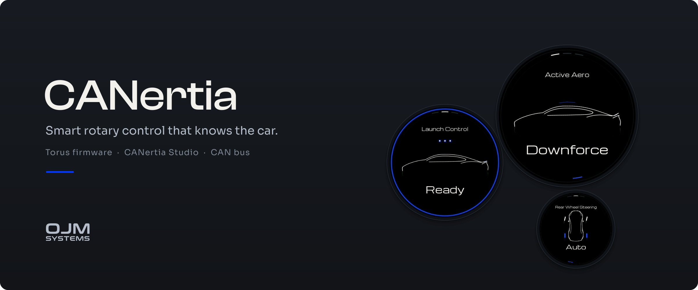
</p>

<p align="center">
  
  
  
  
  
</p>

# CANertia

This is my bachelor's project at VSB – Technical University of Ostrava: a **smart rotary controller for a sporty
electric car**. I call the device **Torus** and its software **CANertia**. On my bench I test it with **CANertia
Studio**, a PC app I wrote that pretends to be the car.

The idea behind the project is simple: a physical knob in a car should know what the car is doing. A Torus reads the
car's state over CAN (speed, parked / driving / charging, braking), and it changes what it offers and what it lets you
choose. It still works completely on its own, without a PC or an ECU.

| | What it is |
|---|---|
| **Torus** | The device: ESP32-S3, 1.32" round 466×466 AMOLED, a rotating barrel with a push button in the middle, CAN bus. The plan is three of them in one console: Energy, Drive and **Performance**. Performance is the one I have built so far. |
| **CANertia** | The firmware and UI running on the Torus. |
| **CANertia Studio** | A Windows app (Python + Qt). It sends the car state, mirrors and controls the Torus through a USB-CAN adapter, and runs a guided demo for presentations. |

---

## The startup

<p align="center">
  
</p>
<p align="center">
  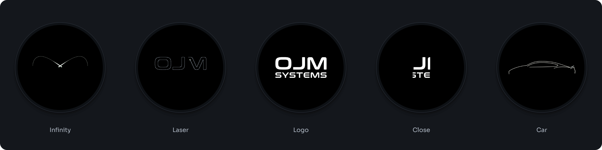
</p>

1. Two balls draw an infinity sign.
2. A laser traces my logo with sparks.
3. The logo lights up.
4. It closes into a dot.
5. The car is drawn.

It takes 6.5 s, and its last frame is exactly the first frame of the UI, so there is no jump. Every Torus image in this
README is a real frame from the firmware renderer; I didn't mock anything up.

## The Performance Torus

<p align="center">
  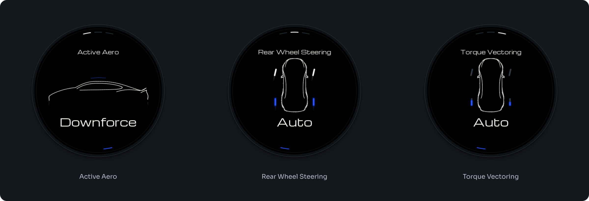
</p>

| Function | Options |
|---|---|
| **Active Aero** | Auto · Low Drag · Downforce · Air Brake |
| **Rear Wheel Steering** | Off · Auto · Stable · Agile |
| **Torque Vectoring** | Off · Auto · Sport · Drift |

You only need three gestures: **turn, click and long press**.

- Turning in the menu changes the page. A click opens the selector, and turning then picks a mode.
- The mode is sent after 250 ms of rest, so spinning fast through the options doesn't send everything in between.

<table>
  <tr>
    <td align="center" width="33%">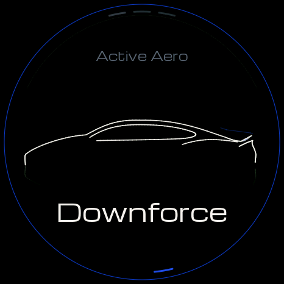<br><sub>Aero: zooms in on the wing</sub></td>
    <td align="center" width="33%">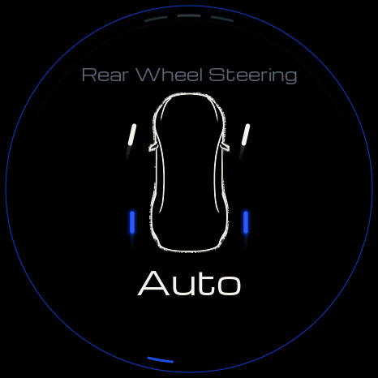<br><sub>RWS: the rear wheels follow the mode</sub></td>
    <td align="center" width="33%">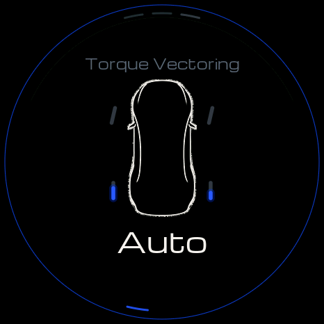<br><sub>TV: torque pours into each wheel</sub></td>
  </tr>
</table>

## What makes it "smart"

<p align="center">
  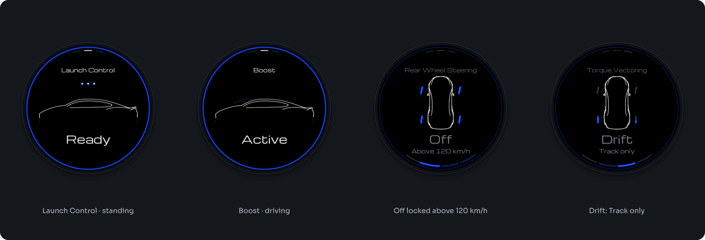
</p>

- **Auto modes follow the car.**
  - Aero: Low Drag when slow, Downforce from 80 km/h, and Air Brake under hard braking.
  - RWS: Agile below 60 km/h, Stable above.
- **One gesture, two meanings.**
  - Hold the knob while standing and you get **Launch Control**. The start lights go out as the car pulls away.
  - Hold it while driving and you get **Boost** for 10 s, with a countdown ring.
- **Safety locks.**
  - RWS Off and TV Off can't be chosen above 120 km/h, and Drift only works in Drive Mode Track.
  - When you hit a locked option, the Torus tells you why.
  - If something asks for a locked value over CAN, it gets refused.
- **Safe default.** If the car data disappears, the Torus behaves as if the car were standing.

<table>
  <tr>
    <td align="center" width="50%">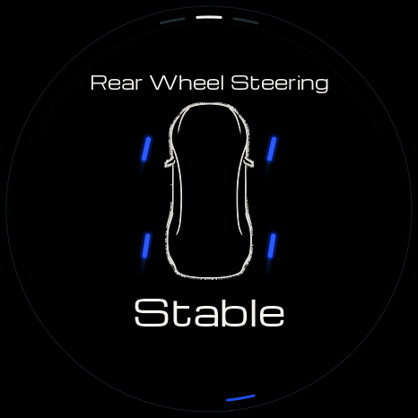<br><sub>Launch Control and Boost</sub></td>
    <td align="center" width="50%">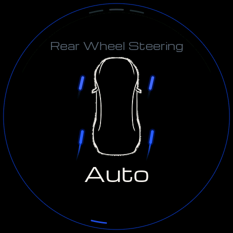<br><sub>Locked options explain themselves</sub></td>
  </tr>
</table>

## CANertia Studio

<p align="center">
  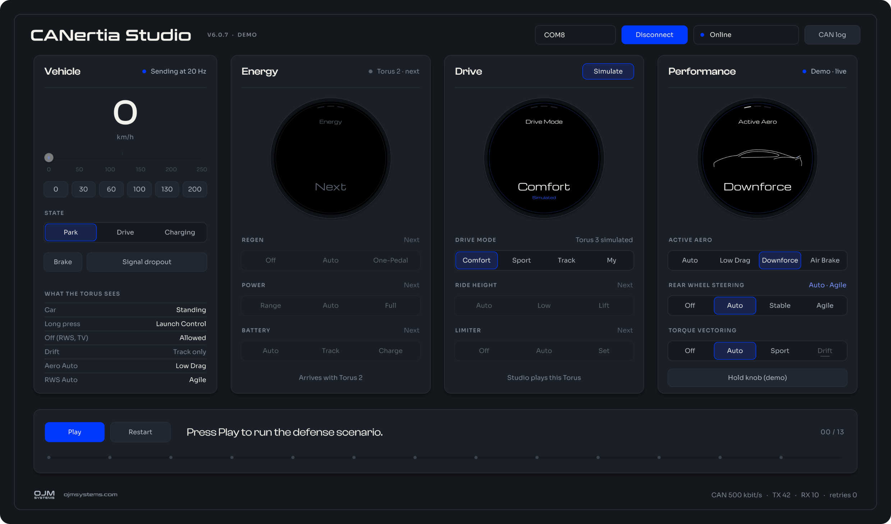
</p>

I don't have a real car on my desk, so Studio plays one. You set the speed and whether the car is parked, driving or
charging, and Studio sends that to the Torus 20 times a second. "What the Torus sees" uses the same rules as the
firmware.

- **Live mirror.** The Performance card mirrors the real Torus live, and you can change modes from the PC too.
  - Studio won't send locked options, and it shows when the Torus refuses something.
  - Until I build the Drive Torus, Studio plays that one as well.
- **Scenario.** A 13-step scenario walks through everything with captions, which is handy for presentations.
- **CAN log.** You can open a readable log of the CAN traffic.
- **Same startup.** Studio starts with the same animation as the Torus.

<table>
  <tr>
    <td align="center" width="50%"><br><sub>100 km/h: Auto picks Downforce and Stable</sub></td>
    <td align="center" width="50%">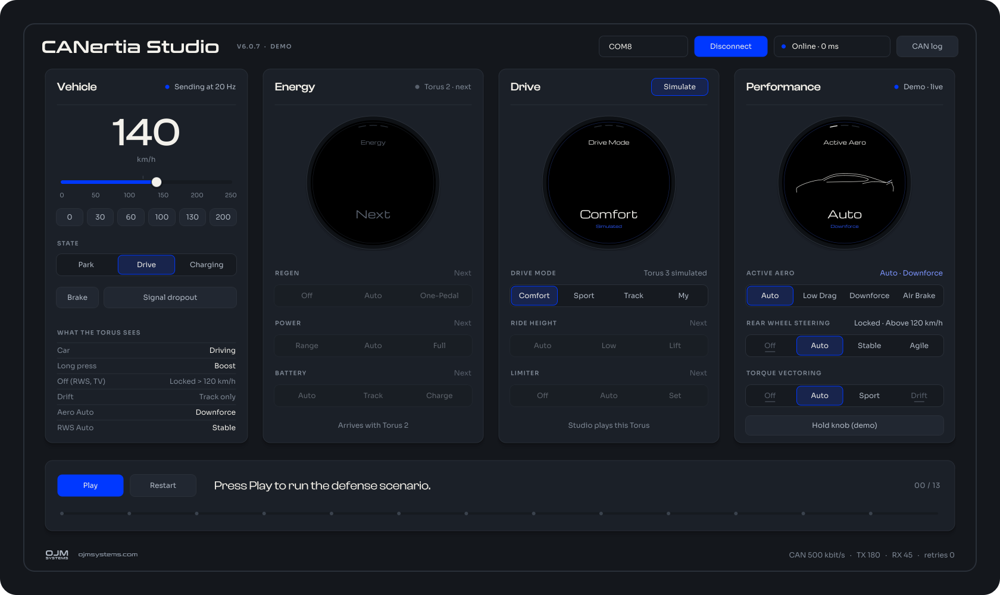<br><sub>140 km/h: Off is locked</sub></td>
  </tr>
  <tr>
    <td align="center">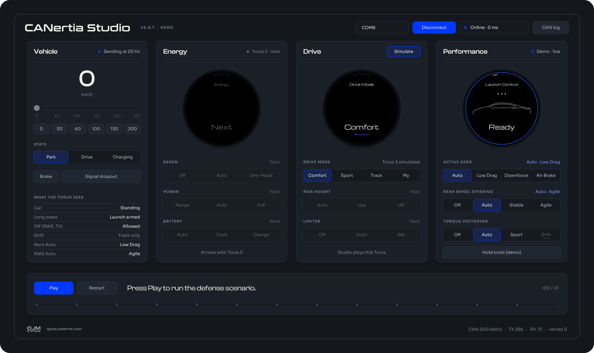<br><sub>Launch Control, mirrored live</sub></td>
    <td align="center">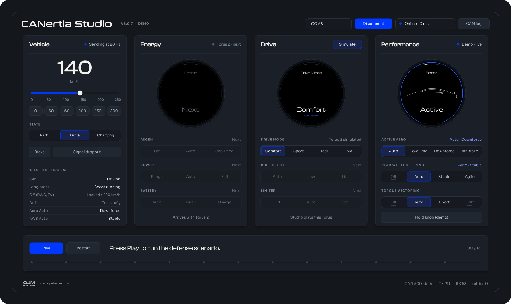<br><sub>Boost running</sub></td>
  </tr>
  <tr>
    <td align="center">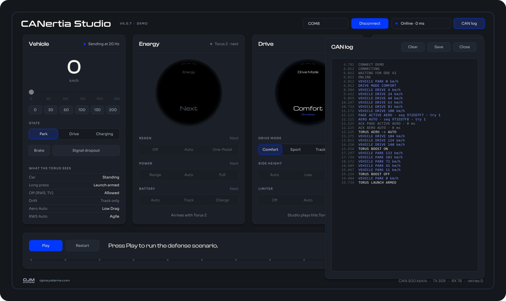<br><sub>CAN log</sub></td>
    <td align="center">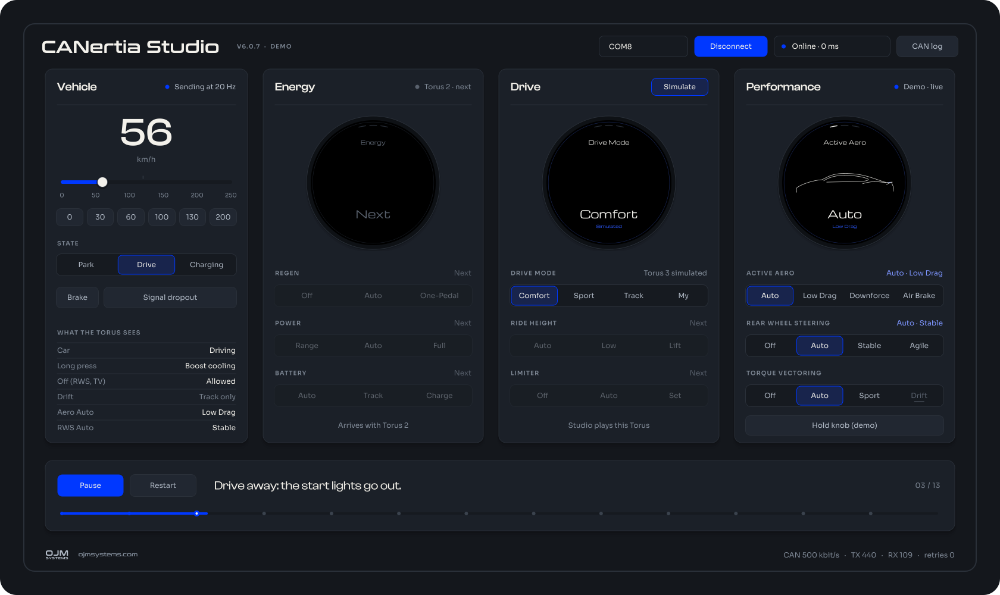<br><sub>Guided scenario</sub></td>
  </tr>
</table>

## How it fits together

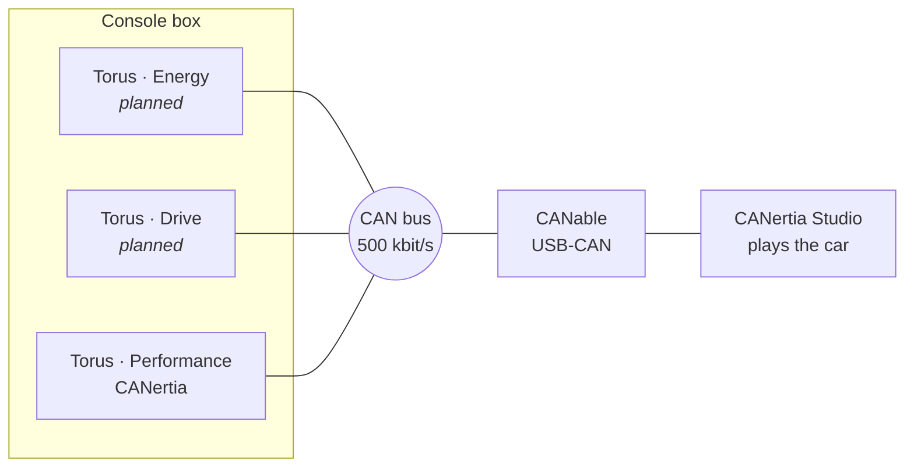

| ID | Direction | Content |
|---|---|---|
| `0x100` | car → every Torus | Car state: park / drive / charging, speed (0.1 km/h), brake |
| `0x201` | Performance → car | State: page, RWS, TV, Aero, Launch / Boost bits, heartbeat 200 ms |
| `0x301` | car → Performance | Command with a sequence number (page, RWS, TV, Aero) |
| `0x211` | Performance → car | ACK: 0 applied, 1 refused |
| `0x202` | Drive → others | Drive Mode: Comfort / Sport / Track / My |

The full byte layouts are in [docs/CAN_PROTOCOL.md](docs/CAN_PROTOCOL.md). My working notes are in Czech.

## Things I learned making it smooth

Getting a 466×466 round display to animate smoothly on a microcontroller was the hardest part of the project. The UI
now runs at about 60 fps on the board, and every frame lands on the display's refresh signal. What made the
difference:

- **Repaint only what changed.** Only the parts of the screen that changed are repainted, split between both CPU
  cores.
- **Overlap painting and sending.** The transfer to the display (DMA, ESP32-S3 segmented SPI transactions) runs while
  the cores are still painting the next parts.
- **Respect the display controller.** The CO5300 only accepts update windows with even coordinates, and they have to
  be widened before drawing, not after. This bug cost me a while.
- **Test every frame.** Tests compile the real firmware on the PC and check that every frame sent to the display is
  identical to a clean full render.

## Running it

**Firmware.** Arduino core esp32 3.3.10, with the `GFX Library for Arduino` and `ESP32Encoder` libraries:

```bash
arduino-cli compile --fqbn "esp32:esp32:esp32s3:CDCOnBoot=cdc,FlashSize=8M,PartitionScheme=huge_app,PSRAM=opi" OJM_DDE_Dynamics
arduino-cli upload -p COM4 --fqbn "esp32:esp32:esp32s3:CDCOnBoot=cdc,FlashSize=8M,PartitionScheme=huge_app,PSRAM=opi" OJM_DDE_Dynamics
```

**CANertia Studio** (Python 3.10+):

```bash
pip install -r Vehicle_ECU_Simulator/requirements.txt
python Vehicle_ECU_Simulator/main.py --demo         # a simulated Torus, no hardware needed
python Vehicle_ECU_Simulator/main.py --port COM8    # with a CANable, then press Connect
```

On Windows, `Vehicle_ECU_Simulator/INSTALL.bat`, `START.bat` and `DEMO.bat` do the same thing.

**Clash Display.** Studio uses Clash Display for headings. Its licence doesn't allow me to share the font files, so
they aren't in this repo. Download it from [Fontshare](https://www.fontshare.com/fonts/clash-display) and put
`ClashDisplay-Regular.otf`, `-Medium.otf` and `-Semibold.otf` into `assets/fonts/`. Without it, headings use Sora.

**Tests:**

```bash
python -m unittest discover -s tests -v                 # protocol, CAN engine, Studio GUI
python tools/test_renderer.py --node <path-to-node>     # the real firmware, frame by frame (needs ziglang)
```

The host tests need `pip install -r tools/requirements.txt`.

## What's in the repo

| Path | Contents |
|---|---|
| [`OJM_DDE_Dynamics/`](OJM_DDE_Dynamics) | Torus firmware (CANertia) |
| [`Vehicle_ECU_Simulator/`](Vehicle_ECU_Simulator) | CANertia Studio |
| [`tests/`](tests), [`tools/`](tools) | Tests and asset generators |
| [`assets/`](assets) | Logo outlines, car drawings, fonts |
| [`docs/`](docs) | Wiring, CAN protocol, startup timeline, changelog and my notes (mostly Czech) |
| [`legacy/`](legacy) | My first prototype (a climate-control dial) and older snapshots |

## Where it is now

| | |
|---|---|
| **Performance Torus** | Works on the real board. This is CANertia V0.1. |
| **CANertia Studio** | V0.1, tested with the board over a CANable. |
| **Energy and Drive Torus** | *Planned.* Same firmware core, different role at build time. |
| **Studio** | *Next:* proper throttle and brake physics. |

My very first prototype was a climate-control dial; it lives in [`legacy/`](legacy/README.md). Here's a
[video of it](https://www.youtube.com/watch?v=JF2uquMCpn4&t=3s). Wiring and pins are in
[docs/WIRING.md](docs/WIRING.md).

## Thanks

Waveshare provided the display hardware. Miniware (TS101 Go Kit), Fanttik (E1 Max screwdriver) and iFixit (FixMat and
Manta Driver Kit) helped me with tools for building and bench work, and KORAD confirmed support with a KA3005PS power
supply. None of them had any say in the design, the code or the results.

## License

I haven't chosen a license yet. Until I add one, the project stays under default copyright while I confirm the
publication terms with my supervisor.

The bundled fonts are under the SIL Open Font License 1.1: Michroma, Sora and DINish (see [`licenses/`](licenses)).
Clash Display isn't included.

<p align="center"><sub>Ondřej Josef Macek · OJM Systems · <a href="https://ojmsystems.com">ojmsystems.com</a></sub></p>
